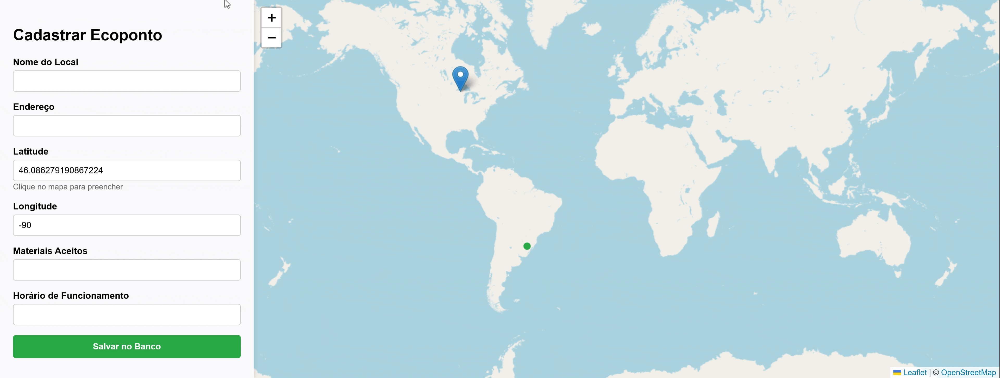

<h1>Mapa de Coleta de Resíduos (Ecopoint Map)</h1>

<h2>Acesso</h2>

O projeto está publicado e pode ser acessado através do link: 
<a href="https://elc1090.github.io/project3-2026b-FabricioDD/">https://elc1090.github.io/project3-2026b-FabricioDD/</a>

<em>(Backend API hospedado em: <code>https://project3-2026b-fabriciodd.onrender.com</code>)</em>

<h2>Desenvolvedor(a)</h2>

<strong>Fabrício Thomas Freitas Santos</strong> - Curso: <strong>Sistemas de Informação</strong> (GitHub: FabricioDD)

<h2>Proposta</h2>

<em>Desenvolvimento sobre o sistema do projeto 2 de mapeamentopara ecopontos e locais de reciclagem. O objetivo é permitir que a comunidade cadastre e edite facilmente pontos de descarte adequados para diferentes tipos de materiais.</em>

<h2>Parceria/cliente/usuário</h2>

<strong>Nenhum</strong>

<h2>Feedback/comentário da parceria/cliente/usuário</h2>

<strong>Nenhum</strong>

<h2>Desenvolvimento</h2>

<h3>Processo</h3>
<blockquote>
  
<em>Nota: Adapte o texto abaixo para que fique com a sua voz e reflita 100% a sua experiência pessoal.</em>

</blockquote>

A transição deste projeto de um modelo mais simples (usando Supabase como backend-as-a-service) para uma arquitetura mais mão na massa e separada (Frontend no GitHub Pages e Backend próprio em Node.js no Render.com, com BD no Neon.tech) foi o maior desafio do desenvolvimento.

Implementei Autenticação baseada em JWT (JSON Web Tokens) e criptografia de senhas com <code>bcrypt</code> no banco Neon.tech (PostgreSQL). Quando ativei a amarração entre ecopontos e os usuários (donos do ponto), percebi que os pontos antigos que não tinham autor começaram a sumir do mapa. Descobri que o erro estava no backend: uma query SQL com <code>INNER JOIN</code> estava filtrando pontos sem dono. A solução foi alterar a instrução para <code>LEFT JOIN</code>, permitindo que ecopontos antigos não fossem excluídos da interface pública.

Sinceramente, o ponto mais dificil desse trabalho foi construir a nova infraestrutura em cima da que já tinha sido implementada no projeto dois. Foi resolvido com revisão de código e ajuda de IA.

<h3>Trechos de código</h3>

<strong>1. Alternância Dinâmica de Login/Logout na Interface</strong> 
Para melhorar a experiência do usuário e manter o mapa em tela cheia, criei um botão flutuante inteligente. O JavaScript verifica a presença do JWT no <code>localStorage</code> e altera não apenas o texto, mas as classes CSS e a rota de redirecionamento do botão dinamicamente:

<pre><code class="language-javascript">function verificarSessao() {
    const token = localStorage.getItem('token');
    const btnAuth = document.getElementById('btnAuth');
    
    if (!token) {
        btnAuth.innerText = "Fazer Login";
        btnAuth.className = "btn-login";
        btnAuth.onclick = () => window.location.href = 'login.html';
    } else {
        btnAuth.innerText = "Sair da Conta";
        btnAuth.className = "btn-logout";
        btnAuth.onclick = () => {
            localStorage.removeItem('token');
            localStorage.removeItem('usuarioNome');
            window.location.reload();
        };
    }
}
</code></pre>

<strong>2. JWT e Controle de Acesso (Super Usuário)</strong> 
No backend, implementei uma verificação para permitir que administradores (<code>is_admin</code>) possam excluir ou editar qualquer ponto, enquanto usuários comuns só conseguem modificar os pontos que eles mesmos criaram (<code>usuario_id = $2</code>).

<pre><code class="language-javascript">let query, valores;

if (req.usuario.is_admin) {
    query = `DELETE FROM pontos_de_coleta WHERE id = $1 RETURNING *;`;
    valores = [pontoId];
} else {
    query = `DELETE FROM pontos_de_coleta WHERE id = $1 AND usuario_id = $2 RETURNING *;`;
    valores = [pontoId, usuarioId];
}
const resultado = await pool.query(query, valores);
</code></pre>

<strong>3. Resolução de pontos órfãos com SQL (LEFT JOIN)</strong> 
Quando a tabela de usuários foi ligada aos ecopontos, a busca inicial filtrada por <code>JOIN</code> fez os pontos antigos sumirem. Trocar para <code>LEFT JOIN</code> corrigiu o problema e evitou a quebra do mapa público:

<pre><code class="language-javascript">const query = `
    SELECT pontos_de_coleta.*, usuarios.nome AS autor
    FROM pontos_de_coleta
    LEFT JOIN usuarios ON pontos_de_coleta.usuario_id = usuarios.id;
`;
</code></pre>

<h2>Tecnologias</h2>

<h3>Linguagens e afins</h3>
<ul>
  <li><strong>Frontend:</strong> HTML5, CSS3, JavaScript (Vanilla JS).</li>
  <li><strong>Mapas:</strong> Biblioteca <a href="https://leafletjs.com/">Leaflet.js</a> e Leaflet Routing Machine.</li>
  <li><strong>Backend:</strong> Node.js, <a href="https://expressjs.com/">Express.js</a>.</li>
  <li><strong>Banco de Dados:</strong> PostgreSQL (Hospedado no <a href="https://neon.tech/">Neon.tech</a>).</li>
  <li><strong>Segurança &amp; Autenticação:</strong> JWT (jsonwebtoken), bcrypt, e configuração de CORS.</li>
  <li><strong>Integração de banco:</strong> Biblioteca <code>pg</code> (node-postgres).</li>
</ul>

<h3>Ambiente de desenvolvimento</h3>
<ul>
  <li><strong>Editor:</strong> Visual Studio Code (VS Code).</li>
  <li><strong>Hospedagem Frontend:</strong> GitHub Pages.</li>
  <li><strong>Hospedagem Backend (API):</strong> Render.com.</li>
  <li><strong>Controle de Versão:</strong> Git e GitHub.</li>
  <li><strong>Auxílio ao Desenvolvimento:</strong> Gemini (Assistente de IA).</li>
</ul>

<h2>Referências e créditos</h2>
<ul>
  <li>Documentação Oficial do Leaflet: <a href="https://leafletjs.com/reference.html">https://leafletjs.com/reference.html</a></li>
  <li>Documentação do Express.js: <a href="https://expressjs.com/">https://expressjs.com/</a></li>
  <li>Documentação do PostgreSQL (Neon): <a href="https://neon.tech/docs/introduction">https://neon.tech/docs/introduction</a></li>
  <li>[PREENCHER: Adicione aqui vídeos tutoriais do YouTube que você tenha usado, se houver]</li>
  <li>[PREENCHER: Dê o crédito a colegas que tenham ajudado em alguma dúvida ou teste do site]</li>
</ul>

Projeto entregue para a disciplina de <a href="http://github.com/andreainfufsm/elc1090-2026b">Desenvolvimento de Software para a Web</a> em 2026b.

